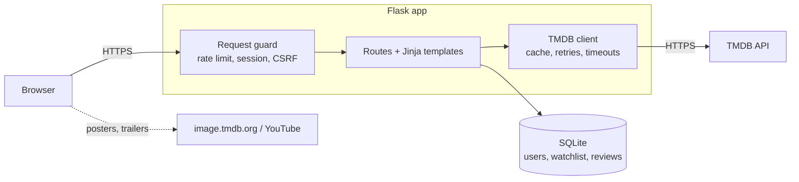
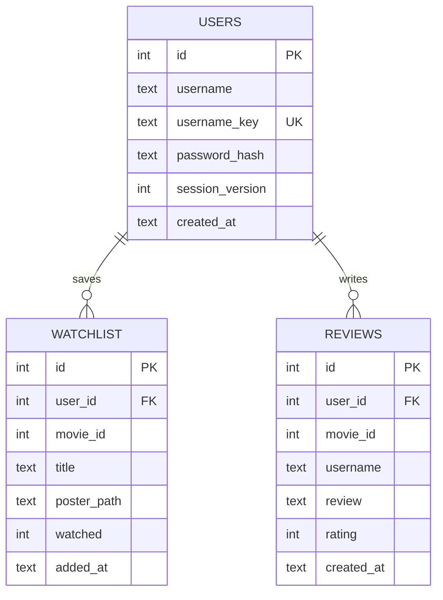

<div align="center">

# 🎬 FilmyQui

**A secure, full-stack movie discovery app: browse what's popular, watch trailers, keep a private watchlist and write star-rated reviews.**

[](https://github.com/punit-ch/filmyqui/actions/workflows/tests.yml)


[Video demo](https://youtu.be/61XkvAn5n8w?si=ax6pfGaNNtgYaGNO) · [Security audit](SECURITY_AUDIT.md) · [Deploy for free](DEPLOY.md)

<!-- Add your live link here once deployed, for example:
**Live demo: https://YOURNAME.pythonanywhere.com** -->

</div>

#### Video Demo: https://youtu.be/61XkvAn5n8w?si=ax6pfGaNNtgYaGNO

#### Description:

FilmyQui is a movie discovery web app built with **Flask, Python, SQLite, Jinja, HTML, CSS and a little vanilla JavaScript**, using live data from [The Movie Database (TMDB)](https://www.themoviedb.org/) API. You can browse popular, top rated, in-theatre and upcoming movies, filter by genre, search by title, watch trailers, see the cast, create an account, keep a private watchlist, and write star-rated reviews. It is my final project for **CS50x**.

I picked cinema because it is one of my biggest interests, and I wanted a dynamic app that talks to a real third-party API **and** stores its own data (accounts, watchlists, reviews), instead of a static page. The project grew well beyond the course requirements: it now has real authentication, per-user data access, a security-focused request pipeline, a 68-test suite with continuous integration, and a deploy guide for free hosting.

---

## Table of contents

- [Features](#features)
- [Screenshots](#screenshots)
- [Tech stack](#tech-stack)
- [How it works](#how-it-works)
- [Security](#security)
- [Testing and CI](#testing-and-ci)
- [Getting started](#getting-started)
- [Configuration](#configuration)
- [Deployment](#deployment)
- [Project structure](#project-structure)
- [Design decisions](#design-decisions)
- [Challenges and what I learned](#challenges-and-what-i-learned)
- [Roadmap](#roadmap)
- [Credits](#credits)
- [License](#license)
- [Author](#author)

---

## Features

**Discover**
- **Home page** with a featured-movie banner, four lists (Popular, Top rated, In theatres, Coming soon), scrollable genre chips and pagination.
- **Search by title** with a result count, pagination and a friendly empty state.
- **Movie pages** with poster, tagline, year, runtime, TMDB rating, genres, overview, director, the top 12 cast members, an official trailer and 12 recommendations.
- **Click-to-load trailer.** The page shows a thumbnail and only loads the YouTube player (privacy-enhanced `youtube-nocookie` domain) when you press play, so pages open fast.

**Your account**
- **Sign up, log in, log out**, change your password (which logs out your other devices), and **delete your account** together with everything attached to it.
- A **private watchlist**: add or remove from any page, mark movies as watched, and see them as ticket stubs in "Watch next" and "Watched" sections. Only you can see or change your list.
- **Reviews**: a 1-5 star rating plus text (up to 2,000 characters), posted under your username, one review per movie. The movie page shows the community average and the latest 50 reviews, and you can delete your own reviews (and only your own).

**Experience**
- Responsive layout from phones to desktops, keyboard-friendly with visible focus and a skip link, and **works without JavaScript**.
- Motion that is easy on the eyes and **switches off for people who ask for reduced motion**.

## Screenshots

<!-- Add screenshots to docs/screenshots/ and uncomment, for example:

| Home | Movie page |
|---|---|
|  |  |

| Watchlist | Reviews |
|---|---|
|  |  |
-->

See the [video demo](https://youtu.be/61XkvAn5n8w?si=ax6pfGaNNtgYaGNO) for a walkthrough.

## Tech stack

| Area | Choice | Why |
|---|---|---|
| Language and framework | **Python 3.11+, Flask 3.1** | Small, readable, and every part of the request flow stays visible |
| Templates | **Jinja2** (auto-escaping on) | Server-rendered pages; escaping by default is the first line of defence against XSS |
| Database | **SQLite** with parameterised queries | Zero setup, a single file, plenty for this workload |
| External data | **TMDB API** via `requests` | Real, rich movie data with images, cast and trailers |
| Passwords | **scrypt** through Werkzeug | Memory-hard hashing with a per-password salt |
| Front end | **Plain CSS and vanilla JavaScript** | No build step, no framework, no inline code (so a strict CSP is possible) |
| Production server | **gunicorn** (or the host's WSGI server) | Standard for Flask |
| Tests and CI | **pytest**, **GitHub Actions**, `pip-audit`, `bandit`, `gitleaks` | Tests on every push, plus dependency, code and secrets scans |

## How it works



1. **Every request passes the guard.** It applies an overall rate limit, loads the session, works out who is logged in, and for any POST verifies the CSRF token.
2. **Routes fetch movie data through one TMDB client.** The client adds timeouts, retries when TMDB says "slow down" or is briefly down (waiting at most 2 seconds), friendly error messages, and a 10-minute in-memory cache that drops its oldest entries when full. A movie page needs just **one** TMDB call, because `append_to_response` returns details, videos, cast and recommendations together.
3. **User data lives in SQLite**, and every query that touches personal data is filtered by the logged-in user's id.
4. **Templates render the page**, escaping everything by default. The browser loads posters and trailers directly from TMDB and YouTube.

### Pages and routes

| Route | Method | Who | What it does |
|---|---|---|---|
| `/` | GET | Everyone | Home: featured movie, lists, genres, pagination |
| `/search` | GET | Everyone | Search by title |
| `/movie/<id>` | GET | Everyone | Movie details, trailer, cast, recommendations, reviews |
| `/register`, `/login` | GET, POST | Everyone | Create an account, log in |
| `/logout` | POST | Logged in | Log out |
| `/account` | GET | Logged in | Account overview |
| `/account/password` | POST | Logged in | Change password |
| `/account/delete` | POST | Logged in | Delete the account and its data |
| `/watchlist` | GET | Logged in | Your watchlist |
| `/watchlist/add`, `/remove`, `/watched` | POST | Logged in | Change your watchlist |
| `/review` | POST | Logged in | Post a review |
| `/review/<id>/delete` | POST | Logged in | Delete your own review |

### Data model



The database itself enforces the important rules: one watchlist row per user and movie, one review per user and movie, ratings between 1 and 5, review length up to 2,000 characters, and foreign keys with cascading deletes. `init_db()` creates the tables and upgrades older databases in place every time the app starts.

## Security

Security was a main goal of this project, not an afterthought. The full write-up, including what was found and fixed, is in [SECURITY_AUDIT.md](SECURITY_AUDIT.md).

| Risk | How it is handled |
|---|---|
| **Weak or stolen passwords** | scrypt hashes with per-password salts. Passwords of 10-128 characters, with common and username-based passwords rejected. Passwords are never stored or logged in plain form. |
| **Brute-force logins** | Rate limits per address (10 attempts per 10 minutes) and per account (10 per 15 minutes). Wrong passwords and unknown usernames give the same message, and an unknown username still costs the same time. |
| **Session theft and fixation** | Fresh session at every login, `HttpOnly`, `SameSite=Lax`, `Secure` and `__Host-` cookie in production, 30-day sliding lifetime. Changing your password logs out your other devices. |
| **Accessing other people's data** | Every watchlist and review query is filtered by user id in SQL. Deleting someone else's review answers "not found". Tests try each of these as a second user. |
| **Cross-site request forgery** | A per-session CSRF token is checked on every POST. |
| **Cross-site scripting** | Jinja auto-escaping, no `\|safe`, text cleaned on the server (control and text-direction characters removed), TMDB image paths and trailer ids checked against strict patterns, and **no inline scripts or styles** so the Content-Security-Policy can forbid them. |
| **SQL injection** | Every query is parameterised. |
| **Open redirects** | `next` targets must be paths on this site, checked as written and with percent-escapes undone. |
| **Abuse and spam** | Overall per-visitor limit, per-account review limit, hidden honeypot field, one review per movie, and a 32 KB cap on request bodies. |
| **Clickjacking, sniffing, leaks** | `Content-Security-Policy`, `X-Frame-Options`, `X-Content-Type-Options`, `Referrer-Policy`, `Permissions-Policy`, cross-origin opener and resource policies, HSTS over https, and `no-store` on account pages. |
| **Cross-origin access** | CORS is deliberately not enabled; a test confirms no `Access-Control-*` header is ever sent. |
| **Leaked secrets** | Keys only come from environment variables. The TMDB key never appears in a page, error or log, and `TMDB_READ_TOKEN` keeps it out of URLs altogether. `.env` and the database are git-ignored, and CI scans the Git history with gitleaks. |
| **Unsafe start-up** | The app refuses to start without a random `SECRET_KEY` of 32+ characters, and refuses to run in debug mode on a proxied (production) host. `ALLOWED_HOSTS` rejects unexpected Host headers. |
| **Exposed files** | Only `/static` is served, and a test requests `.env`, `app.py`, the database and path-traversal tricks. A route-inventory test fails if an admin or debug route is ever added by accident. |

> This is a careful review plus automated tests, not a professional penetration test.

## Testing and CI

- **68 pytest tests** run without internet or an API key, because they use a fake TMDB.
- They cover accounts, who can see whose data, XSS, CSRF, rate limits, headers, start-up safety, database upgrades, and the TMDB client itself (retries, timeouts, caching, bad responses).
- To check the tests really protect the code, I deliberately broke the app in 20 places (for example a delete query that forgets the owner) and confirmed the tests failed each time.
- **GitHub Actions** runs the tests on Python 3.11 and 3.12 for every push and pull request, plus a weekly security job: `pip-audit` (vulnerable dependencies), `bandit` (static analysis) and `gitleaks` (secrets in the history). Dependabot proposes dependency updates.

## Getting started

**Prerequisites:** Python 3.11 or newer, Git, and a free [TMDB API key](https://www.themoviedb.org/settings/api).

```bash
# 1. Get the code
git clone https://github.com/punit-ch/filmyqui.git
cd filmyqui

# 2. Create a virtual environment and install dependencies
python -m venv .venv
source .venv/bin/activate / .venv\Scripts\Activate.ps1         # Windows PowerShell: .venv\Scripts\Activate.ps1
pip install -r requirements-dev.txt

# 3. Add your settings
cp .env.example .env               # Windows: copy .env.example .env
# open .env and fill in TMDB_READ_TOKEN (or API_KEY)

# 4. Run it
flask --app app run --debug
# open http://127.0.0.1:5000
```

In debug mode on your own machine `SECRET_KEY` may be left empty. For anything else, generate one:

```bash
python -c "import secrets; print(secrets.token_hex(32))"
```

Run the tests with `pytest`.

## Configuration

Settings come from environment variables or a `.env` file next to `app.py` (see [.env.example](.env.example)).

| Variable | Required | Purpose |
|---|---|---|
| `TMDB_READ_TOKEN` | One of these two | TMDB "API Read Access Token", sent in a header so it never appears in a URL (recommended) |
| `API_KEY` | One of these two | TMDB "API Key (v3 auth)" (`TMDB_API_KEY` also works) |
| `SECRET_KEY` | In production | Signs login sessions; at least 32 random characters |
| `DATABASE_PATH` | Recommended when deployed | Where the SQLite file lives; point it at a persistent disk |
| `TRUST_PROXY` | Behind a proxy | Set to `1` so rate limiting sees each visitor's real IP |
| `ALLOWED_HOSTS` | Recommended when deployed | Comma-separated domains the app will answer to |

## Deployment

The accounts live in a SQLite file, so the host needs a **persistent disk**. [DEPLOY.md](DEPLOY.md) is a step-by-step guide for hosting FilmyQui **for free on PythonAnywhere** (HTTPS included). On any other host with a persistent disk, the start command is:

```bash
gunicorn app:app --workers 2
```

Set the variables from the table above in the host's dashboard (never commit them), serve only over https, and back up the database file regularly.

## Project structure

```text
filmyqui/
├── app.py                 # Routes, accounts and sessions, TMDB client, database helpers,
│                          #   input cleaning, rate limiter, security headers, error handlers
├── templates/             # Jinja pages: layout, index, movie, search, watchlist,
│   │                      #   login, register, account, error
│   └── _macros.html       # Reusable movie card, pagination, stars, password field
├── static/
│   ├── styles.css         # All styling: glass surfaces, grid, motion, responsive rules
│   └── app.js             # Optional polish: trailer on click, scrollers, reveal, tilt
├── tests/
│   ├── conftest.py        # Test setup (secret key, resets caches and rate limits)
│   └── test_app.py        # 68 tests with a fake TMDB
├── .github/
│   ├── workflows/tests.yml  # Tests + pip-audit + bandit + gitleaks
│   └── dependabot.yml       # Weekly dependency updates
├── requirements.txt       # Runtime dependencies (pinned ranges)
├── requirements-dev.txt   # Plus pytest, pip-audit, bandit
├── .env.example           # Template for your settings (the real .env is git-ignored)
├── DEPLOY.md              # Free-hosting guide
├── SECURITY_AUDIT.md      # What was checked, found, fixed and still your job
└── pytest.ini
```

## Design decisions

- **Server-rendered Flask, no front-end framework.** The site is mostly pages of content, so Jinja templates keep it fast, simple and accessible. JavaScript only adds polish.
- **One TMDB wrapper.** Timeouts, retries, error messages and caching live in one function, so no route has to think about them. Error messages never include the request URL, which could contain an API key.
- **Accounts without email, on purpose.** A username and password keep the scope focused. The trade-off is no password reset, which is listed in the roadmap.
- **Rules in the database, not just in Python.** Unique indexes, `CHECK` constraints and foreign keys mean that a bug in a route cannot quietly create duplicate or invalid data.
- **No inline code anywhere.** Scripts and styles live in files, which is what lets the Content-Security-Policy block injected code outright.
- **Cinema look.** A deep wine background with a marquee-gold accent, glass surfaces, and Bricolage Grotesque for headings with Figtree for text. Motion (a slow push-in on the featured poster, headline words that blur into focus, spotlight and tilt on posters, scroll reveal) is written in plain CSS and JavaScript, takes inspiration from patterns popularised by [React Bits](https://reactbits.dev/), and is fully disabled for people who prefer reduced motion.

## Challenges and what I learned

- **Posters that looked stretched.** The HTML `width` and `height` attributes were fighting the CSS and distorting images. The fix was a fixed 2:3 frame with `height: auto`, checked by measuring real rendered sizes in a headless browser.
- **A watchlist shared by everybody.** Reviewing my own code showed the first version kept one global list. Fixing it meant rethinking identity, first with per-browser sessions and then with real accounts and per-user queries, plus a database migration for existing data.
- **Trusting data from an API.** Even trusted third-party data can be hostile or malformed. I now validate image paths and trailer ids, cope with non-JSON responses, and never put TMDB values into inline styles.
- **Testing without the network.** Replacing TMDB with a fake made the tests fast and repeatable, and a second set of tests fakes the network layer to prove retries, timeouts and caching behave.
- **Security is a pipeline, not a feature.** Rate limits, CSRF, headers, validation and access checks only work together, and tests that try to break each one (as a second user, a bot or a hostile API) caught real mistakes.

## Roadmap

- [ ] Email for password reset and verification, and two-factor login
- [ ] AI-assisted search: describe a movie in your own words and get matches
- [ ] Personal recommendations based on your reviews
- [ ] Combined genre, year and language filters, including Indian regional cinema
- [ ] "Where to watch" information
- [ ] A shared rate limiter (Redis) and PostgreSQL for larger deployments
- [ ] Self-hosted fonts to remove the third-party request

## Credits

- Movie data and images come from [TMDB](https://www.themoviedb.org/). *This product uses the TMDB API but is not endorsed or certified by TMDB.*
- Fonts: [Bricolage Grotesque](https://fonts.google.com/specimen/Bricolage+Grotesque) and [Figtree](https://fonts.google.com/specimen/Figtree) from Google Fonts.
- Motion ideas inspired by [React Bits](https://reactbits.dev/); the code here is my own plain-JavaScript version.
- Built as the final project for [CS50x](https://cs50.harvard.edu/x/).

## License

Released under the [MIT License](LICENSE). Movie data and images remain the property of TMDB and its contributors and are subject to [TMDB's terms of use](https://www.themoviedb.org/api-terms-of-use).

## Author

**Punit Chavan**, full-stack software engineer based in Pune, India.

- GitHub: [@punit-ch](https://github.com/punit-ch)
<!-- Add your portfolio, LinkedIn or email here -->

If you like the project, a ⭐ on the repository is much appreciated.